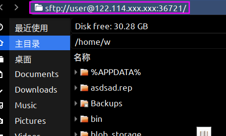

# javaSftpserver
Servidor ssh/sftp nativo multiplataforma compilado con graalvm, con un tamaño de solo 6 MB. (Si te es útil, por favor dame una estrella >_<)


## uso
Utiliza comandos para ejecutar archivos en la máquina que será administrada.

args:   usuario passMd5  host puerto
```bash
iptables -A INPUT -p tcp --dport   36721 -j ACCEPT #If your machine is linux, you need to open the port for connection
./javaSftp-1.0-SNAPSHOT_UPX  test e10adc3949ba59abbe56e057f20f883e 122.114.xxx.xxx  36721  #user=test pass=123456 (e10adc3949ba59abbe56e057f20f883e)
```

Luego puedes conectarte desde el administrador de archivos en Linux/Windows

-  linux
 nautilus 


- windows: Necesitas algún software como WinSCP

##  problemas
-  No se puede conectar al servidor sftp
Puedes ejecutar primero `ssh usuario@host -p puerto` para intentar conectarte al servicio ssh objetivo. Si tu servidor sftp se reinició anteriormente, se generará una nueva clave en el directorio `~/.ssh` del cliente. Intenta eliminar la información de la clave en el archivo `known_hosts` y reconéctate después.
```bash
xxx@xxxx~> ssh test@122.114.xxx.xxx -p 36721                                                                                                                                                                    14:17:09
@@@@@@@@@@@@@@@@@@@@@@@@@@@@@@@@@@@@@@@@@@@@@@@@@@@@@@@@@@@
@    WARNING: REMOTE HOST IDENTIFICATION HAS CHANGED!     @
@@@@@@@@@@@@@@@@@@@@@@@@@@@@@@@@@@@@@@@@@@@@@@@@@@@@@@@@@@@
IT IS POSSIBLE THAT SOMEONE IS DOING SOMETHING NASTY!
Someone could be eavesdropping on you right now (man-in-the-middle attack)!
It is also possible that a host key has just been changed.
The fingerprint for the ECDSA key sent by the remote host is
SHA256:mwYLNeXGp6svf9pJ8z98QWzghWbBE4rm0Sfhcs1QdpE.
Please contact your system administrator.
Add correct host key in /home/xxx/.ssh/known_hosts to get rid of this message.
Offending ECDSA key in /home/xxx/.ssh/known_hosts:1
  remove with:
  ssh-keygen -f "/home/xxx/.ssh/known_hosts" -R "[122.114.xxx.xxx]:36721"
ECDSA host key for [122.114.xxx.xxx]:36721 has changed and you have requested strict checking.
Host key verification failed.
```


##  compilación
Clona este proyecto con git y ábrelo con un IDE. Espera a que maven compile las clases que se puedan compilar.

### jar
Debido a que existen algunos errores de símbolos que requieren otras dependencias, estos aumentarían el tamaño del archivo binario ejecutable. Por lo tanto, opté por no corregirlos (no afecta las funciones básicas)

```bash
cd  javaSftpserver
 mvn assembly:attached -f "pom.xml"  #They will output all class files to the target folder
``` 
Se generará un jar en el directorio target


### native image

#### linux
```bash
cd  javaSftpserver
./build.sh
```
Para realizar la compilación nativa con éxito, resolví la dependencia de registro de SLFJ de Apache SSHD. Se han llevado a cabo la configuración y optimización previas a la compilación. Puedes ejecutar build.sh para compilar después de instalar graalvm. Al aplicar la compresión upx, el tamaño del archivo de salida se reduce a 6 MB.

#### windows

En teoría, es compatible con Windows, necesitas descargar la versión de Windows de graalvm e instalar native-image. Y reemplaza la ruta de native-image en build.sh, ingresa en la consola

```bash
[your mvn path] assembly:attached -f "pom.xml"
[your native-image path]    --no-fallback   -H:+ReportExceptionStackTraces  --no-server   --initialize-at-build-time   --allow-incomplete-classpath     -H:DynamicProxyConfigurationFiles=proxyClass.json --enable-all-security-services   -H:ReflectionConfigurationFiles=reflectionConfig.json      --pgo    -jar target/javaSftp-1.0-SNAPSHOT.jar

```

# Español
Este es un servidor ssh/sftp multiplataforma implementado en Java, compilado nativamente con graalvm a una imagen binaria de solo 6 MB. Generalmente lo uso para administrar archivos de Docker y archivos de VPS remotos. Se ha compilado y probado en Linux Ubuntu 18 x64 (admite eliminar/crear/modificar/copiar/mover archivos y carpetas, entre otras funciones). Si te es útil, por favor dame una estrella >_<

Para lograr una compilación nativa exitosa, manejé la dependencia de registro SLFJ de Apache SSHD. Se ha realizado la configuración precompilada y optimización PGO. Puedes ejecutar build.sh para compilar después de instalar graalvm. Tras aplicar la compresión upx, el tamaño del archivo de salida se redujo a 6 MB. Para más detalles sobre cómo compilar, consulta la sección en inglés anterior.
